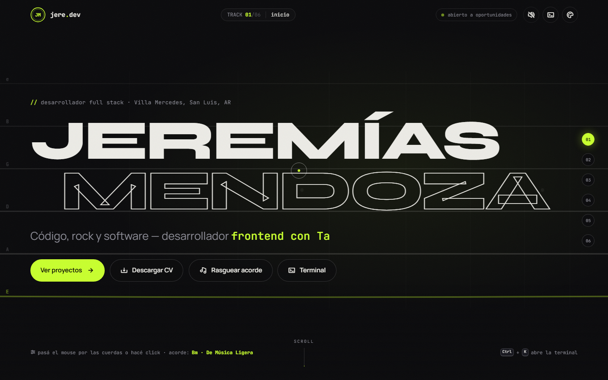
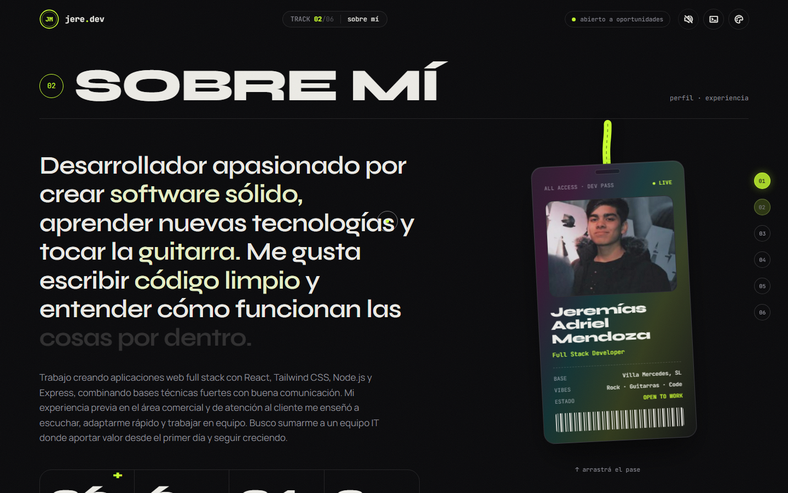
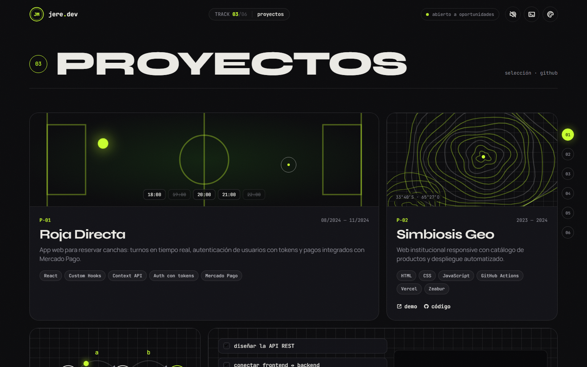
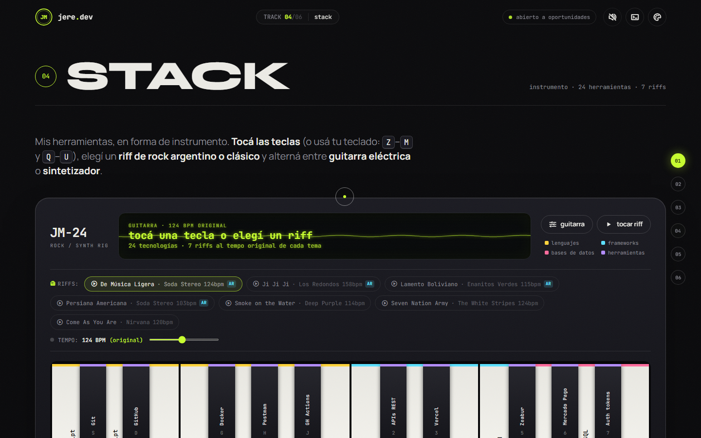
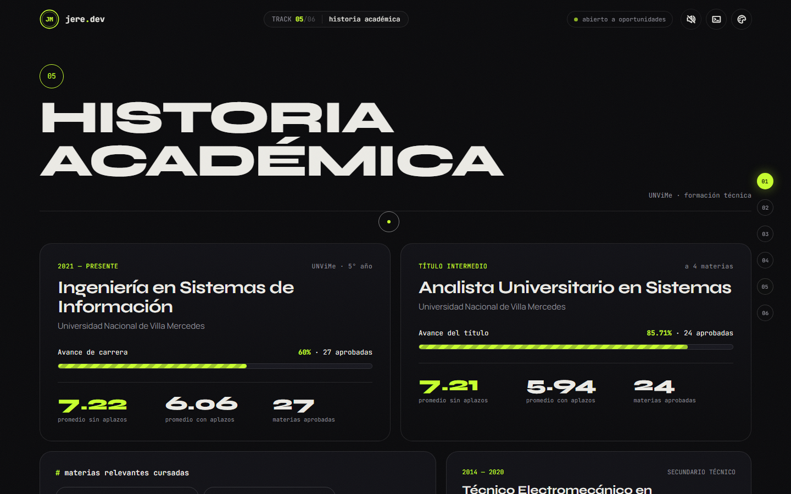
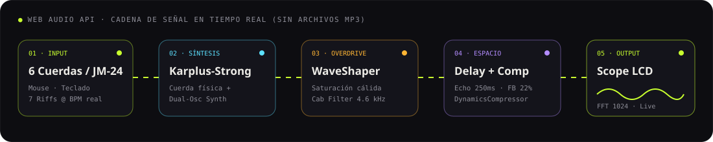
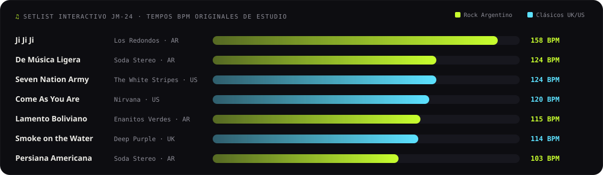

<div align="center">



<br />

<p>
  
  
  
  
  
</p>

<h3>
  Un portfolio web sin plantillas: <b>6 cuerdas de guitarra físicas</b>, un <b>rig interactivo con 7 riffs de rock al BPM original</b>, física Verlet y terminal embebida.
</h3>

<p>
  <a href="#-tour-visual">Tour visual</a> ·
  <a href="#-cadena-de-audio-en-tiempo-real">Motor de audio</a> ·
  <a href="#-setlist-interactivo-jm-24">Setlist &amp; BPM</a> ·
  <a href="#-terminal-embebida">Terminal CLI</a> ·
  <a href="#-instalación-y-despliegue">Instalación</a>
</p>

</div>


## 🎸 Tour visual

<table>
  <tr>
    <td width="50%" valign="top">
      
      <p align="center"><b>01 · Hero interactivo</b> — 6 cuerdas (<code>E A D G B e</code>) con física real y progresión <i>De Música Ligera</i> (<code>Bm → G → D → A</code>).</p>
    </td>
    <td width="50%" valign="top">
      
      <p align="center"><b>02 · Sobre mí &amp; Dev Pass</b> — Credencial colgante <i>All Access</i> arrastrable con física Verlet y brillo holográfico.</p>
    </td>
  </tr>
  <tr>
    <td width="50%" valign="top">
      
      <p align="center"><b>03 · Proyectos &amp; GitHub Live</b> — Bento grid 3D con spotlight, visuales en vivo y archivo sincronizado con la API de GitHub.</p>
    </td>
    <td width="50%" valign="top">
      
      <p align="center"><b>04 · JM-24 Rock / Synth Rig</b> — 24 teclas con las tecnologías del stack, osciloscopio LCD y selector de riffs con control de BPM.</p>
    </td>
  </tr>
</table>

<details>
  <summary><b>🎓 Ver captura de 05 · Historia Académica (UNViMe)</b></summary>
  <br />
  
</details>


## ⚡ Lo que lo hace diferente

| Módulo                           | Qué hace                                                                                                                                             | Tecnología clave                  |
| :------------------------------- | :--------------------------------------------------------------------------------------------------------------------------------------------------- | :-------------------------------- |
| **🎸 Hero de 6 cuerdas**         | Pasás el cursor sobre cualquier cuerda y vibra con física armónica amortiguada; al clickear rasguea acordes completos.                               | `HTML5 Canvas` + `Karplus-Strong` |
| **🎹 Rig JM-24 (Stack)**         | Teclado de 2 octavas tocable con mouse, táctil o teclas `Z–M` y `Q–U`. Alterna entre **guitarra eléctrica** y **sintetizador** con osciloscopio FFT. | `Web Audio API` + `AnalyserNode`  |
| **🪪 Backstage Dev Pass**        | Pase colgante sujeto a una correa de 14 nodos simulada en tiempo real: se puede agarrar, lanzar y ver cómo oscila.                                   | `Verlet Integration` + `SVG Path` |
| **⚡ Bento + GitHub API**        | Tarjetas con inclinación 3D, spotlight radial, fetch real de _Perritos Aleatorios_ y listado automático de repos filtrables por lenguaje.            | `React Hooks` + `GitHub REST API` |
| **⌨️ Terminal CLI (`Ctrl + K`)** | Consola integrada con autocompletado (`Tab`), historial (`↑`/`↓`), navegación, descarga de CV y disparo directo de riffs.                            | `Custom CLI Parser`               |
| **🎨 5 Paletas de acento**       | Cambiá en vivo entre _Lima_, _Ámbar Ampli_, _Rojo Rock_, _Cian_ y _Violeta_ (persistido en `localStorage`).                                          | `CSS Custom Properties`           |


## 🔊 Cadena de audio en tiempo real

Todo el sonido del portfolio se **sintetiza en el navegador desde cero** (cero archivos `.mp3` o samples externos), pasando por una cadena tipo pedalera:

<p align="center">
   Karplus-Strong -> WaveShaper Overdrive -> Delay + Compresor -> Osciloscopio LCD" width="100%" />
</p>


## ♫ Setlist interactivo JM-24

Cada riff está transcripto con sus **figuras rítmicas reales en 4/4** y el **BPM de la grabación original**, con reloj corregido contra _drift_ (`performance.now()`) y slider en vivo (`70–185 BPM`) + reset al tempo original:

<p align="center">
  
</p>


## 💻 Terminal embebida

Presioná <kbd>Ctrl</kbd> + <kbd>K</kbd> (o <kbd>~</kbd>) en cualquier parte del sitio para abrir la terminal:

```bash
jere@portfolio:~$ riffs
riffs disponibles (escribí riff <id>)
  de-musica-ligera     De Música Ligera · Soda Stereo [AR · 124 BPM]
  ji-ji-ji             Ji Ji Ji · Los Redondos [AR · 158 BPM]
  lamento-boliviano    Lamento Boliviano · Enanitos Verdes [AR · 115 BPM]
  persiana-americana   Persiana Americana · Soda Stereo [AR · 103 BPM]
  smoke-on-the-water   Smoke on the Water · Deep Purple [UK · 114 BPM]
  seven-nation-army    Seven Nation Army · The White Stripes [US · 124 BPM]
  come-as-you-are      Come As You Are · Nirvana [US · 120 BPM]

jere@portfolio:~$ riff ji-ji-ji     # scrollea al JM-24 y dispara el riff a 158 BPM
jere@portfolio:~$ acorde           # vuelve al inicio y rasguea las 6 cuerdas
jere@portfolio:~$ academia         # muestra porcentajes y promedios (UNViMe)
jere@portfolio:~$ cv               # descarga el CV en PDF
```

<details>
  <summary><b>📂 Ver arquitectura completa del proyecto</b></summary>

```text
.
├── docs/                           # Gráficos SVG animados y capturas del README
│   ├── banner.svg
│   ├── divider.svg
│   ├── signal-chain.svg
│   ├── riffs-tempo.svg
│   └── preview-*.png
├── public/
│   └── assets/
│       └── CV-Jeremias-Mendoza.pdf
├── src/
│   ├── audio/
│   │   └── audioRig.js             # Motor Web Audio (Karplus-Strong + Overdrive + Synth + FFT)
│   ├── components/
│   │   ├── AboutSection.jsx        # Bio, experiencia laboral y pase con física Verlet
│   │   ├── AcademicSection.jsx     # Historia académica (UNViMe + secundario técnico)
│   │   ├── ContactSection.jsx      # Título de peso variable, email copiable y reloj GMT-3
│   │   ├── CustomCursor.jsx        # Cursor contextual reactivo
│   │   ├── HeroStrings.jsx         # Hero con 6 cuerdas físicas interactivas
│   │   ├── Loader.jsx              # Afinador de entrada E-A-D-G-B-e
│   │   ├── Marquee.jsx             # Cinta tipográfica reactiva a la velocidad del scroll
│   │   ├── ProjectsSection.jsx     # Bento 3D + Perritos API + archivo GitHub live
│   │   ├── StackRig.jsx            # Rig JM-24 + osciloscopio + 7 riffs + control de BPM
│   │   ├── TerminalModal.jsx       # CLI interactiva con Tab y historial
│   │   └── Topbar.jsx              # Barra superior + navegación tracklist 01–06
│   ├── data/
│   │   ├── portfolioData.js        # Acordes, stack de 24 teclas, experiencia y academia
│   │   └── riffs.js                # Partituras MIDI y BPM originales
│   ├── App.jsx
│   ├── index.css                   # Tailwind CSS v4 + keyframes y estilos del rig
│   └── main.jsx
├── index.html
├── package.json
└── vite.config.js
```

</details>


## 🚀 Instalación y despliegue

Requisitos: **Node.js 18+** y **npm**.

```bash
# 1. Clonar el repositorio
git clone https://github.com/jeremendoza01/portafolio.git
cd portafolio

# 2. Instalar dependencias
npm install

# 3. Levantar servidor de desarrollo
npm run dev

# 4. Compilar para producción (genera /dist)
npm run build
```

> **Deploy en 1 click**: configurado con `Vite` y `base: './'`, listo para **Vercel**, **Netlify** o **GitHub Pages** (`Build command: npm run build` · `Output directory: dist`).


<div align="center">

### 📬 Contacto

<p>
  <a href="mailto:mjeremiasadriel@gmail.com">
    
  </a>
  <a href="https://linkedin.com/in/jeremendoza01/">
    
  </a>
  <a href="https://github.com/jeremendoza01">
    
  </a>
  <a href="https://wa.me/542664001759">
    
  </a>
</p>

<sub>Hecho a mano con <b>React + Tailwind CSS + Rock Argentino</b> · Villa Mercedes, San Luis, Argentina</sub>

</div>
